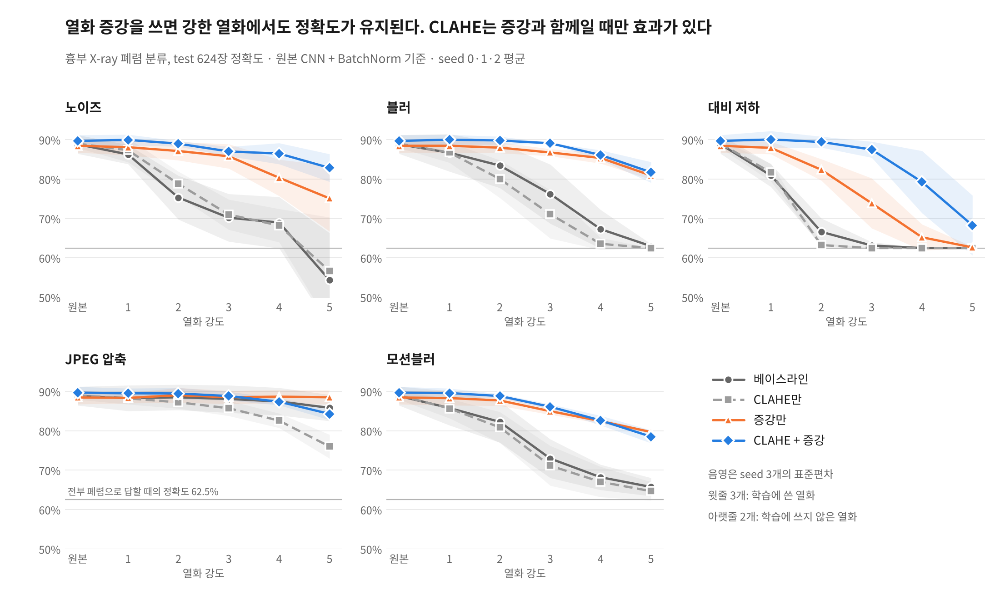
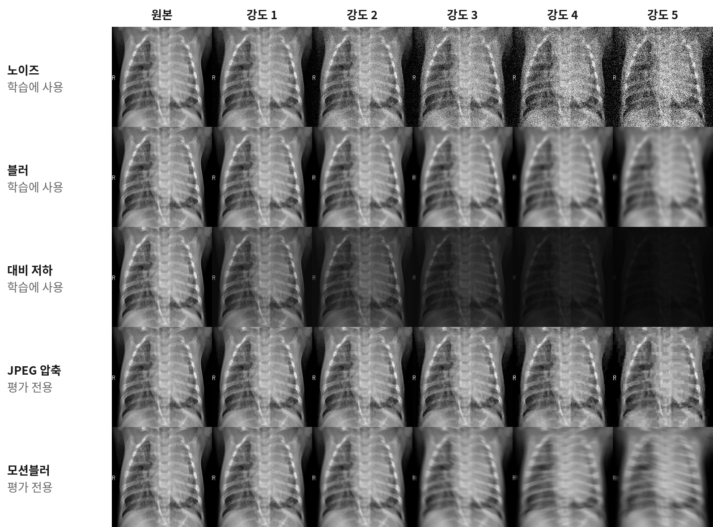

# 흉부 X-ray 폐렴 분류 모델의 열화(저화질) 강건성 개선

GitHub에 공개된 폐렴 분류 모델을 가져와, **영상 화질이 나빠지면 성능이 무너지는 문제**를 측정하고 줄인 수업 과제입니다.

- 원본 모델은 깨끗한 영상에서 약 89%를 맞히지만, 노이즈·블러·대비 저하가 들어가면 거의 모든 영상을 폐렴으로 예측합니다(정확도 62.5%).
- 학습 데이터 양이나 모델 크기를 늘리지 않고 **학습 방식(열화 증강 + CLAHE 전처리)** 만 바꿔서, 열화 영상 정확도를 **71.2% → 85.8%** 로 올리고 깨끗한 영상 정확도는 유지했습니다.



## 목차
1. [참고 코드 (원본)](#1-참고-코드-원본)
2. [문제 정의](#2-문제-정의)
3. [개선한 점](#3-개선한-점)
4. [방법](#4-방법)
5. [결과](#5-결과)
6. [한계](#6-한계)
7. [코드 구성](#7-코드-구성)
8. [실행 방법](#8-실행-방법)
9. [참고 자료](#9-참고-자료)

## 1. 참고 코드 (원본)

| 항목 | 내용 |
|---|---|
| 레포 | [anjanatiha/Pneumonia-Detection-from-Chest-X-Ray-Images-with-Deep-Learning](https://github.com/anjanatiha/Pneumonia-Detection-from-Chest-X-Ray-Images-with-Deep-Learning) (MIT 라이선스) |
| 다운로드 | [zip 파일](https://github.com/anjanatiha/Pneumonia-Detection-from-Chest-X-Ray-Images-with-Deep-Learning/archive/refs/heads/master.zip) |
| 데이터 | [Kaggle Chest X-Ray Images (Pneumonia)](https://www.kaggle.com/datasets/paultimothymooney/chest-xray-pneumonia) — 소아 흉부 X-ray 5,856장, NORMAL / PNEUMONIA 2클래스 |
| 하는 일 | 흉부 X-ray 한 장을 정상 / 폐렴으로 분류 |
| 모델 | 직접 설계한 CNN (Conv-ReLU 10층, 약 54.5만 파라미터, 입력 150×150) |
| 학습 설정 | 기본 증강(기울이기·확대/축소·좌우 반전), Adam, 교차 엔트로피, 클래스 가중치, early stopping |
| 보고 성능 | 깨끗한 test 영상에서 정확도 89.53% |
| 형태 | Keras 2.2.4 / TensorFlow 1.12 (2018) Jupyter 노트북 1개 |

이 레포는 원본의 포크입니다. 원본 노트북은 [`code/`](code/)에, 원본 소개 문서는 [`README_original.md`](README_original.md)에 수정 없이 남겨 두었습니다. **내가 작성한 코드는 모두 [`improved/`](improved/) 폴더에 있습니다.**

## 2. 문제 정의

의료 현장의 X-ray는 저선량 촬영에 따른 노이즈, 환자 움직임에 의한 블러, 장비별 노출·대비 차이, 전송·저장 시 압축을 거칩니다. 원본은 Kaggle이 제공한 깨끗한 영상에서만 평가했기 때문에, 화질이 나빠졌을 때 성능이 유지되는지는 알 수 없습니다.

직접 측정해 보니 원본 구조의 모델은 열화가 조금만 강해져도 **모든 영상을 폐렴으로 예측**하는 상태가 됩니다. test 영상의 62.5%가 폐렴이므로 이때 정확도는 62.5%이고, 정상인 환자를 전부 폐렴으로 오진하는 것입니다.

## 3. 개선한 점

| # | 개선 | 내용 |
|---|---|---|
| 1 | **원본 재현과 학습 실패 수정** | 원본 코드는 현재 환경(TF 2 / Keras 3)에서 실행되지 않아 스크립트로 옮겼습니다([포팅 노트](improved/PORTING_NOTES.md)). 옮긴 뒤에도 학습이 되지 않았는데(loss 0.693 고정), 층별 활성값을 측정해 신호 소실이 원인임을 확인하고 각 Conv 뒤에 BatchNorm을 추가해 88.8%를 재현했습니다. |
| 2 | **열화 평가 기준 추가** | test 624장에 열화 5종 × 강도 5단계 = 25개 조건을 적용해 평가합니다. 이 중 2종(JPEG 압축·모션블러)은 학습에 쓰지 않아 "처음 보는 열화"에 대한 성능을 따로 봅니다. |
| 3 | **열화 증강 + CLAHE 전처리** | 학습 중 영상을 무작위로 열화시켜 보여주고, 대비를 고르게 펴주는 CLAHE 전처리를 더했습니다. 열화 영상 정확도가 71.2% → 85.8%로 올랐습니다. |
| 4 | **원인 분석** | 붕괴가 정보 손실이 아니라 예측 확률이 한쪽으로 쏠리는 현상임을 임계값 분석으로 확인했습니다. BatchNorm 통계 재보정의 효과도 따로 측정했습니다. |
| 5 | **구조 변경 비교** | 사전학습 ViT-S/16 + LoRA 모델을 같은 기준으로 평가해, 모델을 키우는 것과 학습 방식을 바꾸는 것의 효과를 비교했습니다. |
| 6 | **재현성** | 재현 가능한 데이터 분할, 샘플별 난수 고정, seed 3개 반복, 전체 실험을 이어서 돌리는 파이프라인을 만들었습니다. |

## 4. 방법

### 열화 5종 × 강도 5단계



| 열화 | 현실에서의 원인 | 강도 1 → 5 | 학습 증강에 사용 |
|---|---|---|---|
| 가우시안 노이즈 | 저선량 촬영 | σ = 8 → 50 (0–255 밝기 기준) | O |
| 가우시안 블러 | 초점 불량, 미세한 움직임 | σ = 0.6 → 3.0 px | O |
| 대비 저하 | 장비·노출 설정 차이 | 대비 0.75 → 0.18배, 감마 1.4 → 3.6 | O |
| JPEG 압축 | 전송·저장 시 손실 압축 | 품질 40 → 6 | X (평가 전용) |
| 모션블러 | 호흡·몸 움직임 | 커널 길이 3 → 17 px | X (평가 전용) |

### 학습과 평가에 각각 무엇을 썼나

| | 학습 | 평가 |
|---|---|---|
| 영상 | train 4,709장 (수는 늘리지 않음) | test 624장 (모든 모델 동일) |
| 열화 적용 | 매 epoch마다 각 영상에 50% 확률로 무작위 열화 | 깨끗한 상태 1회 + 열화 조건 25개 각각 |
| 열화 종류 | 노이즈·블러·대비 저하 3종 | 5종 전부 |
| 열화 강도 | 1 ~ 4 (낮은 강도일수록 자주) | 1 ~ 5 전부 |
| 열화 합성 | 열화를 거는 영상의 절반은 두 종류를 이어서 적용 | 한 번에 한 종류 |

학습 데이터를 25배로 늘린 것이 아닙니다. 한 epoch에 모델이 보는 영상은 항상 4,709장이고, 그중 약 절반이 매번 다르게 열화된 상태로 들어갑니다.

### 비교한 모델

| 모델 | CLAHE 전처리 | 열화 증강 |
|---|---|---|
| 베이스라인 (원본 + BN) | – | – |
| CLAHE만 | O | – |
| 열화 증강만 | – | O |
| **CLAHE + 열화 증강 (최종)** | O | O |

네 모델 모두 같은 CNN 구조이고 사전학습 가중치 없이 처음부터 학습했습니다. 각 모델을 seed 0·1·2로 세 번씩 학습했습니다.

## 5. 결과

test 624장 정확도(%), seed 3개 평균 ± 표준편차. 열화 열은 강도 1~5 평균입니다.

| 모델 | 깨끗한 영상 | 학습에 쓴 열화 (노이즈·블러·대비) | 학습에 쓰지 않은 열화 (JPEG·모션블러) |
|---|---|---|---|
| 베이스라인 (원본 + BN) | 88.8 ± 2.4 | 71.2 ± 2.3 | 81.3 ± 3.6 |
| CLAHE만 | 89.0 ± 1.1 | 70.6 ± 1.6 | 78.9 ± 2.7 |
| 열화 증강만 | 88.5 ± 1.7 | 81.2 ± 1.3 | 86.6 ± 1.3 |
| **CLAHE + 열화 증강 (최종)** | **89.7 ± 1.5** | **85.8 ± 0.9** | **86.5 ± 0.5** |

- **효과의 대부분은 열화 증강에서 나옵니다.** 증강만으로 학습에 쓴 열화 +10.0%p.
- **CLAHE만 쓰면 효과가 없고, 증강과 함께 쓰면 4.6%p가 더 오릅니다.** 대비 저하에서 가장 큽니다(74.4 → 82.9).
- **깨끗한 영상 정확도는 네 모델이 같은 수준입니다.** 강건성을 올리는 대가로 기존 성능을 잃지 않았습니다.
- **학습에 쓰지 않은 열화의 개선은 모션블러에서 나옵니다**(75.0 → 85.1). JPEG는 베이스라인도 거의 영향을 받지 않습니다.

열화 종류별 (강도 1~5 평균):

| 모델 | 노이즈 | 블러 | 대비 저하 | JPEG | 모션블러 |
|---|---|---|---|---|---|
| 베이스라인 | 71.0 ± 3.6 | 75.3 ± 4.6 | 67.1 ± 1.1 | 87.6 ± 3.3 | 75.0 ± 4.0 |
| CLAHE만 | 72.4 ± 3.8 | 72.8 ± 3.0 | 66.5 ± 0.5 | 84.0 ± 2.0 | 73.9 ± 3.5 |
| 열화 증강만 | 83.3 ± 4.0 | 85.9 ± 1.2 | 74.4 ± 2.4 | 88.6 ± 1.6 | 84.6 ± 1.0 |
| **CLAHE + 열화 증강** | **87.1 ± 1.9** | **87.4 ± 0.5** | **82.9 ± 3.4** | 87.9 ± 1.1 | **85.1 ± 0.4** |

**붕괴의 원인 (임계값 분석, seed 0).** 베이스라인이 무너진 조건에서도 AUC는 0.85 ~ 0.95로 남아 있습니다. 같은 열화를 가한 val에서 임계값만 다시 골라도 학습 열화 정확도가 68.0% → 82.5%로 돌아옵니다. 정보가 사라진 것이 아니라 예측 확률이 한쪽으로 쏠린 것입니다. 최종 모델은 임계값을 바꾸지 않아도(85.5%) 이보다 높습니다.

**구조 변경과의 비교 (ViT-S/16, 각 seed 1개).**

| 모델 | 깨끗한 영상 | 학습에 쓴 열화 | 학습에 쓰지 않은 열화 |
|---|---|---|---|
| ViT + LoRA | 83.8 | 68.7 | 70.1 |
| ViT + LoRA + CLAHE + 열화 증강 | 89.4 | 83.2 | 78.8 |
| ViT 전체 미세조정 | 91.7 | 75.1 | 77.9 |
| CNN, CLAHE + 열화 증강 (최종) | 89.7 | 85.8 | 86.5 |

깨끗한 영상에서는 ViT 전체 미세조정이 가장 높지만, 열화에서는 세 ViT 설정 모두 CNN 최종 모델보다 낮습니다.

BatchNorm 재보정 전후 비교, seed별 수치, 중간 실험과의 차이 등 전체 결과는 [`improved/README.md`](improved/README.md)에, 조건별 원자료는 [`improved/report/per_condition.csv`](improved/report/per_condition.csv)에 있습니다.

## 6. 한계
- 데이터셋 하나(소아 흉부 X-ray), test 624장입니다. seed 간 표준편차가 베이스라인에서 2 ~ 4%p입니다.
- 열화는 합성입니다. 실제 저화질 영상으로 검증하지 않았고, 강도 값에 대한 문헌 근거가 없습니다.
- 학습에 쓰지 않은 열화는 두 종류뿐이고, 개선이 확인된 것은 모션블러 하나입니다.
- 대비 저하 강도 4~5에서는 최종 모델도 크게 떨어집니다(강도 5에서 68.3%).
- 임계값 분석은 seed 0 하나, ViT 비교는 seed 1개입니다.

## 7. 코드 구성

모두 [`improved/`](improved/) 폴더에 있습니다.

| 파일 | 역할 |
|---|---|
| `make_split.py` | train / val / test 분할 (seed 고정) |
| `train_baseline.py` | 원본 CNN 학습. 옵션: `--bn`(BatchNorm), `--clahe`, `--degrade-aug`(열화 증강) |
| `degrade.py` | 열화 5종 × 강도 5단계, 학습용 무작위 증강, CLAHE |
| `eval_robustness.py` | 깨끗한 test + 열화 25개 조건에서 정확도·F1·AUC·클래스별 재현율 측정 |
| `analyze_threshold.py` | 임계값 분석 |
| `data_stats.py` | 데이터셋의 노이즈·대비·선명도 분포 측정 |
| `train_lora_vit.py` | 사전학습 ViT-S/16 + LoRA 학습과 평가 |
| `run_pipeline.py` | 전체 실험을 순서대로 실행하고 요약 표 생성 (끝난 단계는 건너뜀) |
| `demo.py` | 시연: 학습된 모델로 예측과 정확도 확인 |
| `colab_run.ipynb` | Colab 실행 노트북 |
| `report/` | 결과 그림, 조건별 결과 CSV |

## 8. 실행 방법

**Colab (권장).** [`improved/colab_run.ipynb`](improved/colab_run.ipynb)를 GPU 런타임에서 열어 0~3번 셀(환경, 데이터, 분할)을 실행한 뒤 `!python run_pipeline.py`를 실행하면 전체 실험이 순서대로 돕니다.

**로컬.**
```bash
cd improved
pip install -r requirements.txt

# 1) 데이터 분할
python make_split.py --src data/raw/chest_xray --dst data/input --val-ratio 0.1 --seed 42

# 2) 학습: 베이스라인 / 최종 모델
python train_baseline.py --data data/input --tag base_v2 --seed 0 --bn
python train_baseline.py --data data/input --tag both_v2 --seed 0 --bn --clahe --degrade-aug

# 3) 열화 평가 (깨끗한 test + 25개 조건)
python eval_robustness.py --model runs/base_v2_s0/best.keras --tag base_v2_s0
python eval_robustness.py --model runs/both_v2_s0/best.keras --tag both_v2_s0

# 4) 시연: 두 모델의 예측과 정확도를 한 번에 확인
python demo.py --data data/input --runs runs --results results
```

**시연(`demo.py`)이 보여주는 것.** ① X-ray 한 장에 열화 5종 × 5단계를 적용한 그림 ② 무작위로 고른 test 영상의 깨끗한 버전과 열화 버전에 대한 두 모델의 예측 ③ test 624장 전체에 열화를 적용해 계산한 두 모델의 정확도 ④ 전체 실험 요약 표.

## 9. 참고 자료
- 원본 코드: Anjana Tiha, [Pneumonia-Detection-from-Chest-X-Ray-Images-with-Deep-Learning](https://github.com/anjanatiha/Pneumonia-Detection-from-Chest-X-Ray-Images-with-Deep-Learning)
- 데이터: [Kaggle Chest X-Ray Images (Pneumonia)](https://www.kaggle.com/datasets/paultimothymooney/chest-xray-pneumonia)
- Hendrycks et al., "AugMix: A Simple Data Processing Method to Improve Robustness and Uncertainty" (ICLR 2020) — 여러 열화를 합성하는 증강 아이디어
- Hu et al., "LoRA: Low-Rank Adaptation of Large Language Models" (2021)
- 환경: Google Colab T4, TensorFlow 2.21 / Keras 3, PyTorch / timm / peft

코드 작성에 AI 도구(Claude)의 도움을 받았습니다.
