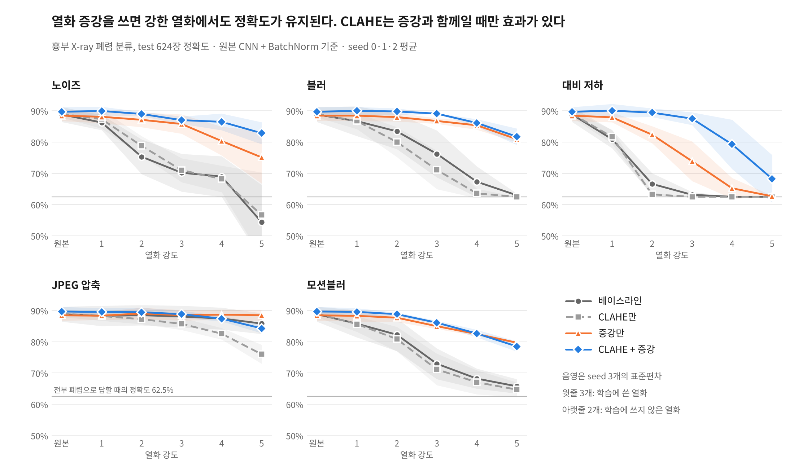

# improved/ — 열화(저화질) 영상에 대한 폐렴 분류 모델 강건성 개선

원본 레포: [anjanatiha/Pneumonia-Detection-from-Chest-X-Ray-Images-with-Deep-Learning](https://github.com/anjanatiha/Pneumonia-Detection-from-Chest-X-Ray-Images-with-Deep-Learning) (MIT)
원본 코드는 `../code/` 노트북 그대로 두고, 이 폴더에 포팅·개선 코드를 추가했습니다.

## 문제 정의
원본 모델은 깨끗한 Kaggle 테스트 영상에서는 약 89% 정확도를 내지만, 실제 현장 조건(저선량 노이즈, 움직임 블러, 노출·대비 편차, 압축)에서는 성능이 어떻게 변하는지 평가되지 않았습니다.
이 작업은 **(1) 열화 벤치마크를 정의해 원본 모델이 무너지는 지점을 측정하고, (2) 전처리·증강·백본 교체로 강건성을 올리면서 깨끗한 영상 성능은 유지**하는 것을 목표로 합니다.

## 원본 대비 변경점
| 구분 | 내용 |
|---|---|
| 포팅 | Keras 2.2.4 / TF 1.12 노트북 → TF 2.x / Keras 3 스크립트 (`train_baseline.py`). 동일 구조·동일 증강·동일 손실. 고친 항목은 `PORTING_NOTES.md` |
| 학습 실패 수정 | 원본 CNN(BN 없는 Conv-ReLU 10층)은 TF2에서 **활성값 소실로 학습이 안 됨**(loss 0.693 고정, 전부 폐렴 예측, acc 0.625). 각 Conv 뒤 BatchNorm 만 추가한 `--bn` 을 수정 베이스라인으로 사용 (채널·커널·풀링·Dense 동일) |
| 데이터 분할 | 원본의 재현 불가능한 320/320 분할 → Kaggle test 624장 고정 + train 10% 를 val 로 (`make_split.py`, seed 고정) |
| 열화 벤치마크 | 노이즈·블러·대비·JPEG·모션블러 × 강도 5단계 (`degrade.py`). JPEG·모션블러는 **홀드아웃**(학습에 미사용) |
| 개선 플래그 | `--clahe` 전처리, `--degrade-aug` 열화 증강, `--backbone efficientnetb0/resnet50` 전이학습 |
| 구조 변경 (LoRA ViT) | `train_lora_vit.py` — ImageNet 사전학습 ViT-S/16 을 고정하고 **LoRA 어댑터(약 60만 파라미터, 2.7%)** 만 학습. `--mode head`(linear probe) / `full`(전체 미세조정) 비교군 포함. 같은 분할·열화·CSV 형식 사용 |
| 시연 | `demo.py` — 학습된 두 모델을 불러와 열화 예시, 예측 비교, test 정확도를 한 번에 출력 |
| 평가 | 깨끗한 test + 25개 열화 조건에서 accuracy/F1/AUC/클래스별 recall → CSV + 곡선 (`eval_robustness.py`) |

## 실행
Colab: `colab_run.ipynb` 를 열어 0~3번 셀 실행 후 `!python run_pipeline.py` (GPU 런타임). 전체 실험을 순서대로 돌리고, 끝난 단계는 건너뜁니다. 추가 분석은 `--stages ablate,single --single-seeds 0,1,2`.

로컬:
```bash
pip install -r requirements.txt
python make_split.py --src data/raw/chest_xray --dst data/input --val-ratio 0.1 --seed 42
python train_baseline.py --data data/input --tag base --seed 0 --bn       # 수정 베이스라인
python eval_robustness.py --model runs/base_s0/best.keras --tag base_s0  # 열화 평가
python train_baseline.py --data data/input --tag both --seed 0 --bn --clahe --degrade-aug
python eval_robustness.py --model runs/both_s0/best.keras --tag both_s0
python eval_robustness.py --compare results/base_s0.csv results/both_s0.csv --out results/compare.png

# 구조 변경: 사전학습 ViT + LoRA (학습·열화 평가 한 번에, 결과는 같은 results/ 형식)
python train_lora_vit.py --data data/input --tag vit_lora --seed 0 --mode lora
python train_lora_vit.py --data data/input --tag vit_lora_both --seed 0 --mode lora --clahe --degrade-aug
python eval_robustness.py --compare results/base_s0.csv results/both_s0.csv results/vit_lora_s0.csv results/vit_lora_both_s0.csv --out results/compare_vit.png
```

## v2 변경 (2026-11-18, 1차 실험 결과 기반)
| 변경 | 근거 (1차 결과) |
|---|---|
| **재현성**: 샘플별 증강 시드 (seed, index, epoch) + TF op determinism | 같은 seed 0 의 base 두 실행이 noise s2 에서 82% vs 67% 로 달랐음. 시드 반복 보고가 성립하려면 필수 |
| **BN 통계 재보정** (학습 후 깨끗한 train 으로 running mean/var 재계산) | aug 단독 모델: 깨끗한 정확도 79.5%, AUC 는 0.954 로 거의 유지, NORMAL 재현율 0.47 → 순위는 멀쩡하고 결정 경계만 밀림. 당시에는 열화 영상이 섞인 BN 통계를 원인으로 봤으나, 2차 결과에서 증강이 없는 베이스라인도 재보정 효과가 컸음(결과 4절) → 원인은 학습 중 이동평균 통계와 추론 입력의 불일치 전반 |
| **증강 v2**: 강도 1~4, 2종 합성 (AugMix 류 다양성) | both 가 블러 s4 에서 base 보다 낮고(0.71 vs 0.75) 홀드아웃 열화에 개선 없음 → 학습 최대 강도 부족 + 단일 열화 암기 |
| **임계값 분석** (`analyze_threshold.py`) | 붕괴 조건에서도 AUC 0.85~0.95 → 임계값 재조정만으로 얼마나 회복되는지 분리 측정 |
| **데이터 통계** (`data_stats.py`) | 열화 강도 값의 근거: 데이터셋 내 노이즈·대비·선명도 분포 위에 강도 1~5 위치 표시 |

## 실험 매트릭스
| tag | bn | clahe | degrade-aug | backbone |
|---|---|---|---|---|
| base_orig | – | – | – | 원본 CNN (학습 실패 재현) |
| base | ○ | – | – | 원본 CNN + BN |
| clahe | ○ | ○ | – | 원본 CNN + BN |
| aug | ○ | – | ○ | 원본 CNN + BN |
| both | ○ | ○ | ○ | 원본 CNN + BN |
| effb0_both | – | ○ | ○ | EfficientNet-B0 |
| vit_lora | – | – | – | ViT-S/16 + LoRA (train_lora_vit.py) |
| vit_lora_both | – | ○ | ○ | ViT-S/16 + LoRA |
| vit_head / vit_full | – | – | – | ViT-S/16 linear probe / 전체 미세조정 (비교군) |

2차 방식 실험은 tag 뒤에 `_v2`가 붙습니다(`base_v2`, `clahe_v2`, `aug_v2`, `both_v2`). CNN 비교는 seed 0·1·2 평균 ± 표준편차로 보고합니다.

## 결과

test 624장 정확도(%), seed 0·1·2 평균 ± 표준편차. 열화 열은 강도 1~5 평균입니다. 조건별 원자료는 [`report/per_condition.csv`](report/per_condition.csv)에 있습니다.

### 1. 원본 재현
원본 CNN 구조를 그대로 포팅하면 학습되지 않습니다(loss 0.693 고정, 전부 PNEUMONIA 예측, 정확도 62.5%, AUC 0.5). 각 Conv 뒤에 BatchNorm만 추가하면 깨끗한 영상에서 88.8 ± 2.4%로, 원본 README의 89.53%와 같은 수준이 됩니다. 이후 모든 비교의 베이스라인은 이 "원본 + BN" 모델입니다.

### 2. 열화에 대한 강건성 — CLAHE × 열화 증강



| 모델 | 깨끗한 영상 | 학습에 쓴 열화 (노이즈·블러·대비) | 학습에 안 쓴 열화 (JPEG·모션블러) |
|---|---|---|---|
| 베이스라인 (원본 CNN + BN) · `base_v2` | 88.8 ± 2.4 | 71.2 ± 2.3 | 81.3 ± 3.6 |
| CLAHE만 · `clahe_v2` | 89.0 ± 1.1 | 70.6 ± 1.6 | 78.9 ± 2.7 |
| 열화 증강만 · `aug_v2` | 88.5 ± 1.7 | 81.2 ± 1.3 | 86.6 ± 1.3 |
| **CLAHE + 열화 증강 · `both_v2`** | **89.7 ± 1.5** | **85.8 ± 0.9** | **86.5 ± 0.5** |

- **열화 증강이 효과의 대부분을 만듭니다.** 증강만으로 학습에 쓴 열화 +10.0%p, 학습에 안 쓴 열화 +5.3%p.
- **CLAHE만 쓰면 효과가 없습니다.** 학습에 쓴 열화 70.6%로 베이스라인(71.2%)과 같습니다.
- **CLAHE는 증강과 함께 쓸 때 학습에 쓴 열화를 +4.6%p 더 올립니다.** 대비 저하(74.4 → 82.9)에서 가장 크고, 노이즈(83.3 → 87.1)에서도 오릅니다.
- **깨끗한 영상 정확도는 네 모델이 같은 수준**입니다(88.5 ~ 89.7).
- 최종 모델은 `both_v2`(CLAHE + 열화 증강)입니다. 학습에 안 쓴 열화에서 세 seed 모두(86.0 ~ 87.2) 베이스라인의 세 seed(76.8 ~ 85.6)보다 높고, seed 간 표준편차도 3.6 → 0.5로 줄었습니다.

열화 종류별 (강도 1~5 평균):

| 모델 | 노이즈 | 블러 | 대비 저하 | JPEG (미사용) | 모션블러 (미사용) |
|---|---|---|---|---|---|
| 베이스라인 | 71.0 ± 3.6 | 75.3 ± 4.6 | 67.1 ± 1.1 | 87.6 ± 3.3 | 75.0 ± 4.0 |
| CLAHE만 | 72.4 ± 3.8 | 72.8 ± 3.0 | 66.5 ± 0.5 | 84.0 ± 2.0 | 73.9 ± 3.5 |
| 열화 증강만 | 83.3 ± 4.0 | 85.9 ± 1.2 | 74.4 ± 2.4 | 88.6 ± 1.6 | 84.6 ± 1.0 |
| CLAHE + 열화 증강 | 87.1 ± 1.9 | 87.4 ± 0.5 | 82.9 ± 3.4 | 87.9 ± 1.1 | 85.1 ± 0.4 |

학습에 안 쓴 열화에서의 개선은 모션블러(75.0 → 85.1)에서 나옵니다. JPEG는 베이스라인도 거의 영향을 받지 않는 열화라 차이가 없습니다(87.6 → 87.9).

### 3. 붕괴의 성격 — 임계값만 다시 잡아도 회복되는가
베이스라인은 열화가 심해지면 전부 PNEUMONIA로 예측합니다(정확도 62.5%). 그런데 같은 조건에서 AUC는 0.85 ~ 0.95로 남아 있습니다. 같은 열화를 가한 val에서 임계값을 다시 고른 뒤 test에 적용하면(`analyze_threshold.py`, seed 0):

| 모델 | | 깨끗한 영상 | 학습에 쓴 열화 | 학습에 안 쓴 열화 |
|---|---|---|---|---|
| 베이스라인 (1차) | 임계값 0.5 | 87.7 | 71.2 | 82.1 |
| 베이스라인 (1차) | val에서 고른 임계값 | 86.4 | 81.6 | 85.3 |
| 베이스라인 `base_v2` | 임계값 0.5 | 85.6 | 68.0 | 76.8 |
| 베이스라인 `base_v2` | val에서 고른 임계값 | 84.5 | 82.5 | 81.5 |
| CLAHE + 열화 증강 `both_v2` | 임계값 0.5 | 91.5 | 85.5 | 87.2 |
| CLAHE + 열화 증강 `both_v2` | val에서 고른 임계값 | 92.5 | 88.9 | 91.0 |

재학습 없이 임계값만 바꿔도 베이스라인의 학습 열화 정확도가 10%p 이상 돌아옵니다. 붕괴의 상당 부분은 정보 손실이 아니라 예측 확률이 한쪽으로 쏠린 것입니다(노이즈 강도 4에서 NORMAL 영상의 평균 P(pneumonia)가 0.35 → 0.98). `both_v2`는 임계값 0.5 그대로도(85.5) 임계값을 보정한 베이스라인(82.5)보다 높습니다. 이 분석은 열화 종류와 강도를 안다고 가정한 것이므로 해결책이 아니라 원인 진단입니다.

### 4. BatchNorm 통계 재보정
학습이 끝난 뒤 깨끗한 train 영상으로 BN의 running mean/var를 다시 계산합니다(가중치는 그대로).

| 모델 | | 깨끗한 영상 | 학습에 쓴 열화 | 학습에 안 쓴 열화 |
|---|---|---|---|---|
| 베이스라인 | 재보정 전 | 83.7 ± 3.6 | 68.9 ± 1.5 | 76.2 ± 4.4 |
| 베이스라인 | 재보정 후 | 88.8 ± 2.4 | 71.2 ± 2.3 | 81.3 ± 3.6 |
| CLAHE + 열화 증강 | 재보정 전 | 88.3 ± 1.8 | 83.5 ± 1.8 | 84.7 ± 1.7 |
| CLAHE + 열화 증강 | 재보정 후 | 89.7 ± 1.5 | 85.8 ± 0.9 | 86.5 ± 0.5 |

깨끗한 영상 정확도는 12개 모델 중 10개에서 오르고 2개는 그대로였습니다. 베이스라인에서 효과가 크고(깨끗한 영상 +5.1%p), 증강 모델에서는 +1 ~ 2%p입니다.

### 5. 구조 변경 — 사전학습 ViT-S/16 (각 1 seed)

| 모델 | 깨끗한 영상 | 학습에 쓴 열화 | 학습에 안 쓴 열화 |
|---|---|---|---|
| ViT + LoRA (어댑터 60만 파라미터) | 83.8 | 68.7 | 70.1 |
| ViT + LoRA + CLAHE + 열화 증강 | 89.4 | 83.2 | 78.8 |
| ViT 전체 미세조정 | 91.7 | 75.1 | 77.9 |

세 설정 모두 학습에 안 쓴 열화에서 `both_v2`(86.5)보다 낮습니다. 이 데이터에서는 모델을 키우는 것보다 학습 방식(열화 증강)이 강건성에 더 크게 작용했습니다. ViT는 1 seed 결과이고 입력 해상도(224)와 사전학습 여부가 CNN과 함께 달라지므로 구조만의 효과로 해석할 수 없습니다.

### 6. 1차 방식과의 차이
1차 방식(증강 강도 1~3, 단일 열화, BN 재보정 없음)의 CLAHE + 증강은 3 seed 평균 85.2 / 78.1 / 79.8로, 학습에 안 쓴 열화에서 베이스라인보다 낮았습니다. 2차 방식(강도 1~4, 2종 합성, BN 재보정)에서 89.7 / 85.8 / 86.5가 되었습니다. 1차에서 "증강만 쓰면 깨끗한 영상 정확도가 떨어진다(79.5%)"고 본 것은 2차 방식에서 재현되지 않았습니다(88.5 ± 1.7).

### 한계
- 데이터셋 하나(Kaggle 소아 흉부 X-ray), test 624장입니다. seed 간 표준편차가 베이스라인에서 2 ~ 4%p로 큽니다.
- 열화는 합성입니다. 학습에 안 쓴 열화는 두 종류뿐이고, 개선이 확인된 것은 모션블러 하나입니다.
- 1차와 2차 방식의 차이는 세 가지 변경을 함께 적용한 결과입니다. 4절에서 BN 재보정의 몫은 분리했지만, 증강 강도와 2종 합성의 몫은 따로 나누지 않았습니다.
- ViT 비교는 1 seed입니다.
- `report/per_condition.csv`와 그림은 Colab 실행 로그에서 추출해 만들었습니다(`report/tools/`). 원본 `results/` 파일은 용량 때문에 레포에 넣지 않았습니다.
